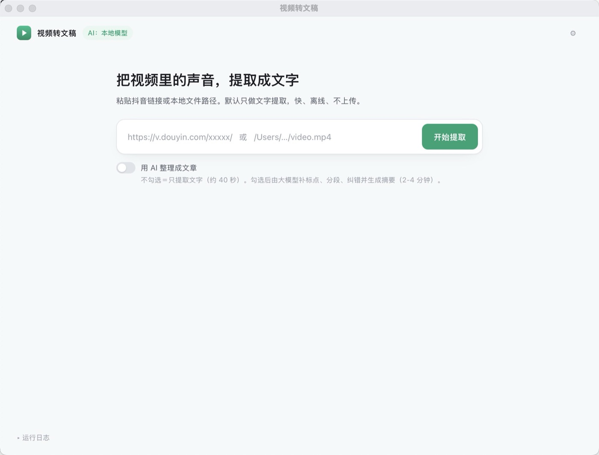
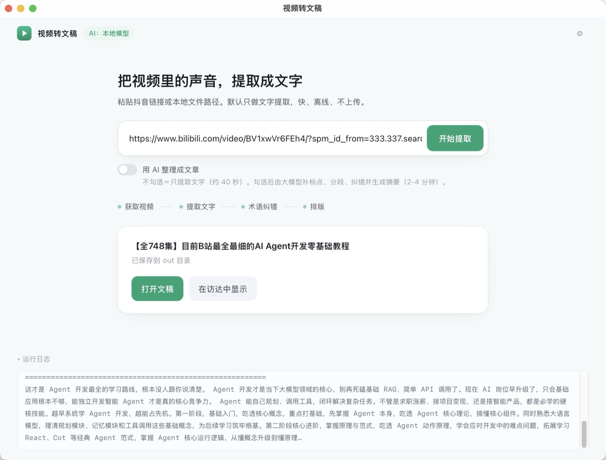

# v2t · 视频转文稿

把视频链接丢进去，得到一份**能直接读的**中文文字稿。

支持抖音（含短链、主页弹窗链接）、B 站、YouTube 等 yt-dlp 覆盖的站点，以及本地文件。

```
链接 → 抓流 → 音频 → Qwen3-ASR 转写 → 术语纠错 → 排版 → Markdown + SRT
```

## 界面

<p align="center">
  
  <br/>
  <sub>打开：一个输入框。默认只提取文字，不碰任何大模型</sub>
</p>

<p align="center">
  
  <br/>
  <sub>完成：四步进度 + 结果卡片，一键打开文稿或定位文件</sub>
</p>


## 它解决什么问题

| | 一般工具 | v2t |
|---|---|---|
| 输出 | 一堆没标点的字幕碎片 | 分段成文，可直接阅读 |
| 标点 | 靠后处理补 | ASR 自带 |
| 专有名词 | 错就错着 | 从视频标题/简介**自动抽取术语**，拼音匹配纠错 |
| 数据 | 上传到别人服务器 | **默认全本地**，可选用自己的大模型 |
| 配置 | 要改配置文件 | 图形界面点选服务商、填 Key 即可 |

## 两种模式

- **提取文字（默认）**：约 40 秒（7 分钟视频）。转写 + 术语纠错 + 规则排版，**不调用任何大模型**。
- **AI 整理成文章（可选）**：2-4 分钟。补标点、分段、纠错，并生成一句话概括、关键要点、数字清单。

## 下载即用（推荐）

到 [Releases](https://github.com/jiashuaiLu/video2text/releases) 下载 `video2text-macOS-arm64.zip`：

1. 解压，把 App 拖进「应用程序」
2. 首次打开：右键点图标 → 打开（未做公证签名，需手动放行一次）
3. 点「开始准备」，App 自动在本机装好运行环境（2-3 分钟，只做一次）
4. 之后粘链接就能用

需要系统里有 `python3` 和 `ffmpeg`（`brew install python ffmpeg`）。首次转写会下载约 2.4GB 语音模型，之后完全离线。

数据目录：`~/Library/Application Support/video2text`

## 从源码开始（macOS Apple Silicon）

```bash
git clone <this-repo> && cd v2t
./setup.sh                 # 建 venv、装依赖（分离线模型另加 --with-models）
./bin/v2t "https://www.bilibili.com/video/BVxxxx"
```

产物在 `out/`：`.md` 文稿、`.txt` 纯文本、`.srt` 字幕。

### 桌面应用

```bash
cd desktop
npm install
npx tauri build          # 产物在 src-tauri/target/release/bundle/macos/
```

界面里可以直接：粘链接 → 开始 → 打开文稿；设置页可选本地/云端模型、填 API Key、测试连接。

## 接自己的大模型

首次运行 `./bin/v2t --init-config` 生成 `config.json`（权限 600）。留空 `api_key` 就用本地模型；填了自动走云端。

| 服务商 | base_url | 模型示例 |
|---|---|---|
| DeepSeek | `https://api.deepseek.com/v1` | `deepseek-chat` |
| 智谱 GLM | `https://open.bigmodel.cn/api/paas/v4` | `glm-4-flash`（免费）|
| 通义千问 | `https://dashscope.aliyuncs.com/compatible-mode/v1` | `qwen-plus` |
| 月之暗面 | `https://api.moonshot.cn/v1` | `moonshot-v1-8k` |
| OpenAI | `https://api.openai.com/v1` | `gpt-4o-mini` |
| OpenRouter | `https://openrouter.ai/api/v1` | 任意 |
| 本机 Ollama | `http://localhost:11434/v1` | `qwen2.5:7b` |

任何 OpenAI 兼容接口都能用，模型名可直接手填。

## 命令行

```bash
./bin/v2t "<链接>"              # 默认：提取文字 + 规则排版
./bin/v2t "<链接>" --polish     # 追加 AI 整理
./bin/v2t "<链接>" --no-format  # 只要转写和字幕
./bin/v2t "<链接>" --asr whisper  # 回退 Whisper（对照用）
./bin/v2t --polish-only 稿子.txt  # 只整理已有文字稿
```

## 术语纠错怎么工作

不从零训练模型，而是三层叠加：

1. **ASR 上下文**：把从标题/简介抽到的词作为偏置喂给 Qwen3-ASR
2. **拼音纠错器**（`bin/glossary.py`，0.3 秒，纯规则）：同音错字（超需求→抄需求）、跨语种音译（撸妈爸→LumaBar）、拉丁词归一（Trust MR→TrustMRR）
3. **大模型**（仅 AI 整理模式）：按上下文判断语义级错误

## 已知限制

- **仅 macOS Apple Silicon**：转写依赖 MLX，Intel Mac / Windows / Linux 需要换推理后端（whisper.cpp 或 faster-whisper）
- 抖音部分内容需要登录态；私密/已删除视频抓不到
- 纯音乐视频没有转写价值
- 规则排版无法修复语义级错误（如「真实曲线」应为「真实案例」）

## 项目结构

```
bin/v2t.py        主流程：抓流 → 转写 → 纠错 → 排版
bin/dy_grab.py    无头 Chrome + CDP 抓抖音真实播放地址
bin/llm.py        模型后端抽象（本地 MLX / OpenAI 兼容 API）
bin/glossary.py   拼音术语纠错器
bin/formatmd.py   非 LLM 排版器（断句、分段、数字规整）
bin/settings.py   图形界面用的配置读写与连通性测试
desktop/          Tauri 桌面应用（Rust + 原生 HTML）
```

## License

MIT。
